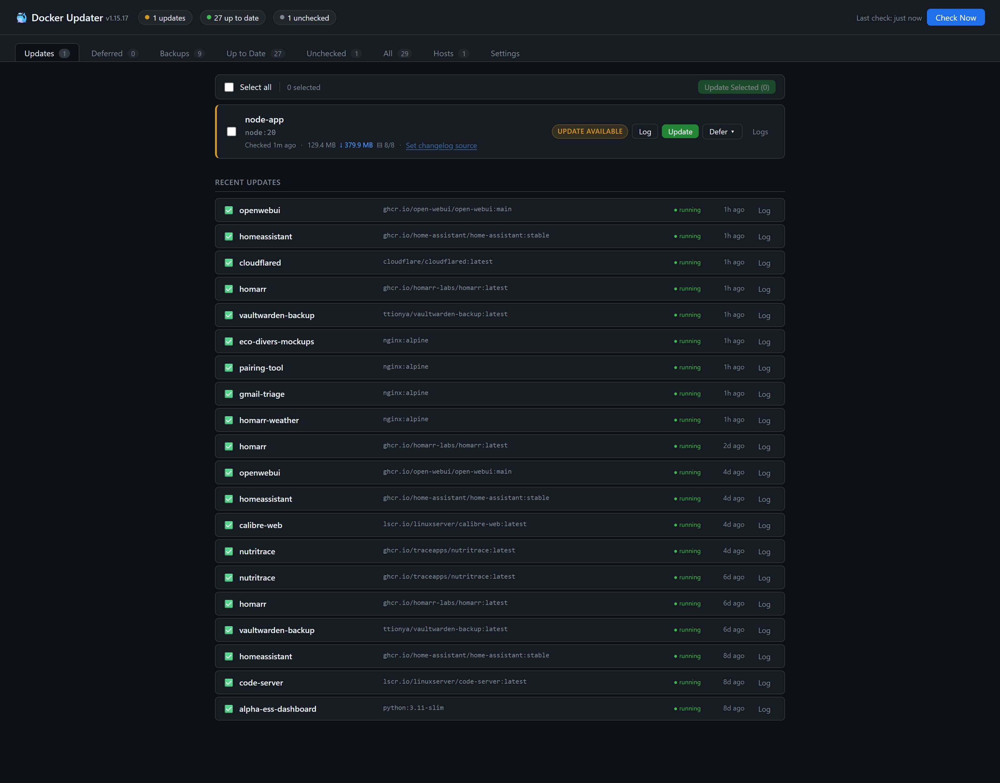
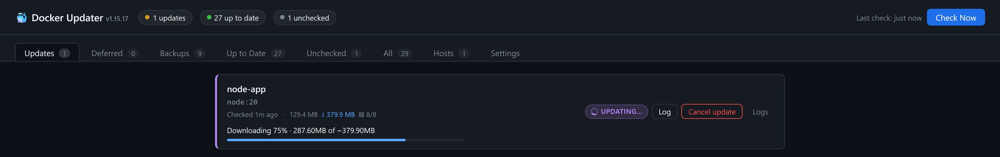
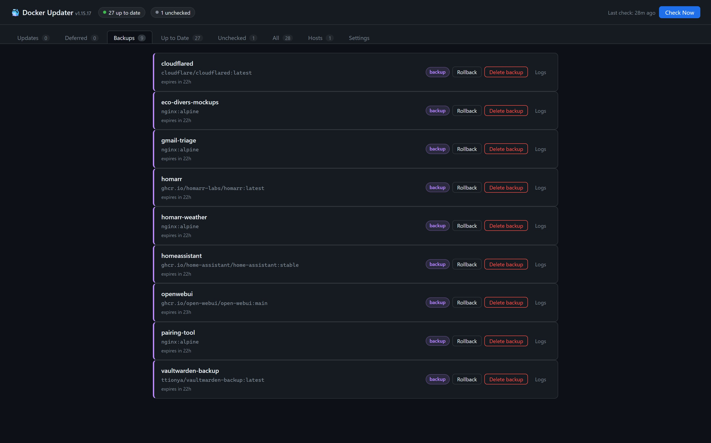
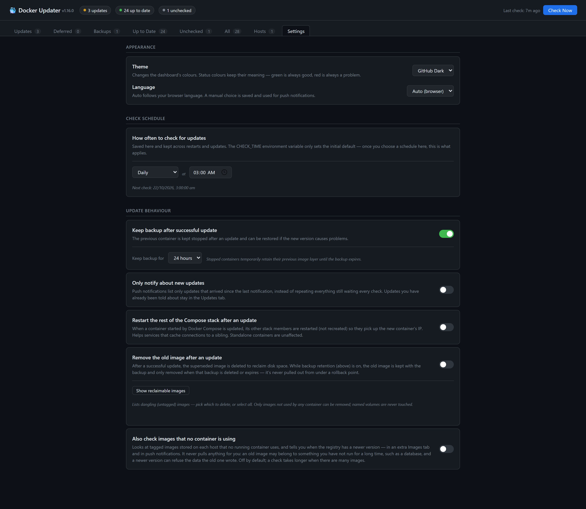
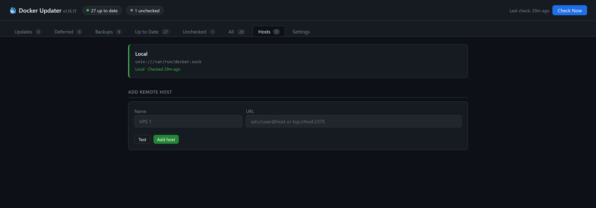
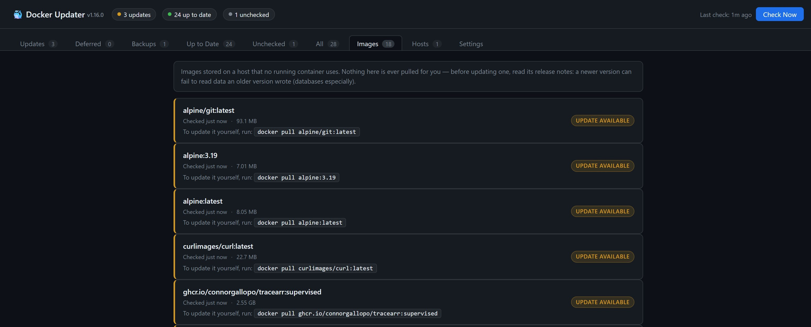

# docker-updater

**English** | [简体中文](README.zh-CN.md)

A lightweight self-hosted web UI for managing Docker container updates — a manual-approval alternative to Watchtower.

Instead of automatically pulling and restarting containers the moment a new image is published, docker-updater polls your registries on a schedule, shows you what's available, and lets you decide when (or whether) to update each container. Updates are performed with a built-in rollback safety net — the old container is kept and can be automatically restored if the new one fails to start. For additional peace of mind, you can optionally retain a backup of the previous container after a *successful* update too — so you can roll back even when a new version comes up cleanly but later turns out to have problems. You can also view release changelogs from GitHub before committing to an update.

---












## Authentication

The dashboard remains open by default for backward compatibility. On public or untrusted networks, set **both** credentials; setting only one logs a warning and leaves authentication disabled.

| Variable | Description |
|----------|-------------|
| `AUTH_USERNAME` | Dashboard username |
| `AUTH_PASSWORD` | Dashboard password |
| `FLASK_SECRET_KEY` | Optional session-signing key; otherwise generated at `/app/data/.secret_key` |
| `API_KEY` | Optional read-only key for dashboards and widgets, see [Read-only API key](#read-only-api-key) |

For Docker Compose, create `.env` beside `docker-compose.yml`:

```dotenv
AUTH_USERNAME=admin
AUTH_PASSWORD='replace-with-a-new-strong-password'
# FLASK_SECRET_KEY='replace-with-a-long-random-value'
```

A Compose `.env` file only supplies `${VARIABLE}` substitutions; it does not automatically inject every value into the container. Use the complete [docker-compose.yml example](#docker-composeyml), which already forwards all three variables. Do not add a second `services:` or `environment:` block.

Apply environment changes by recreating the container (`restart` is not enough):

```bash
docker compose config --quiet
docker compose up -d --force-recreate
```

Verify presence without printing either value, then check the startup log:

```bash
docker compose exec docker-updater sh -c '
  test -n "$AUTH_USERNAME" && echo "AUTH_USERNAME: set" || echo "AUTH_USERNAME: missing"
  test -n "$AUTH_PASSWORD" && echo "AUTH_PASSWORD: set" || echo "AUTH_PASSWORD: missing"
'
docker compose logs --tail=100 docker-updater
```

Successful setup logs `[auth] Login required (user='admin')`; `[auth] Open access` means the variables are missing or empty. In Synology's standalone-container UI, enter both variables in the container settings and recreate it because a nearby `.env` file is not loaded automatically. Paramiko `CryptographyDeprecationWarning` / TripleDES warnings are unrelated to dashboard authentication.

Use the exact filename `.env` (not `.env.txt`), avoid spaces around `=`, protect it with `chmod 600 .env`, and never publish its contents. Sessions last **7 days**. `/webhook/github` remains reachable without a login and still relies on `GITHUB_WEBHOOK_SECRET`. Put the WebUI behind HTTPS when exposing it publicly.

> **Changing the password does not log existing sessions out.** Sessions are signed with `FLASK_SECRET_KEY`, not derived from the password, so a session issued before a password change stays valid until it expires (up to 7 days). If you're changing the password because you think it leaked, rotate the signing key at the same time to invalidate every existing session — either set a new `FLASK_SECRET_KEY`, or delete `data/.secret_key` so a fresh one is generated — then recreate the container.

### Read-only API key

Dashboards such as [Homepage](https://gethomepage.dev) or Homarr only need to *see* the counts, yet signing them in would mean handing them the admin password, which can also trigger updates and rollbacks. Set an optional `API_KEY` instead (at least 16 characters, for example `openssl rand -hex 24`):

```bash
curl -H "Authorization: Bearer $API_KEY" http://your-host:9292/api/status
```

- It works for **`GET /api/status` only**. Every other endpoint, and the dashboard itself, still needs the login. It cannot start an update, a rollback or a check, and it does not create a session.
- It does nothing unless `AUTH_USERNAME` and `AUTH_PASSWORD` are set (without them the dashboard is open anyway), and a key shorter than 16 characters is ignored with a warning in the log.
- Leave it unset and nothing changes.
- Anyone holding the key can read every container name, image and host in `/api/status`, so treat it as a secret, and rotate it by changing the variable and recreating the container.

A community widget for Homepage ([gethomepage/homepage#7305](https://github.com/gethomepage/homepage/discussions/7305)) supports this key — the widget's `key:` setting is sent as the Bearer key. It is not part of Homepage itself yet; see the discussion for details.

## Language

The WebUI supports **English** and **简体中文**:

- **Auto (default)** follows the browser language (`zh*` → Chinese; all others → English).
- **Settings → Appearance → Language** switches immediately between Auto, English, and 中文.
- Manual choices persist in the browser and control push-notification wording; Auto synchronizes the effective browser language to the server.
- Docker log streams, image names, and raw Docker errors remain unchanged.

## Features

- **Registry polling** — compares local image digests against the registry without pulling, using the Docker Registry v2 manifest API (`HEAD` + `Docker-Content-Digest`); the digest compared is the one the container is *actually running*, so a container left behind by an out-of-band `docker pull` is still flagged
- **Multi-registry support** — Docker Hub, GHCR (`ghcr.io`), LinuxServer (`lscr.io`), and any registry that implements the Bearer token challenge
- **Multi-host support** — manage containers across multiple Docker hosts (SSH or TCP) from a single dashboard; SSH host keys are auto-accepted on first Test Connection (TOFU) and persisted across restarts; each host has a connection health indicator and containers are shown together with a host chip
- **Per-container control** — update individually, defer for 7/14/30/90 days or indefinitely, or un-defer at any time. A deferred container stops appearing in update notifications until the deferral expires (the notification says how many are being held back, so nothing goes quietly missing)
- **Bulk updates** — select multiple containers and update them all at once
- **Changelog viewer** — fetches the last 5 GitHub Releases and renders them inline; works automatically for images with an `org.opencontainers.image.source` label or hosted on GHCR (`ghcr.io`); for anything else a *Set changelog source…* prompt lets you pin a GitHub repo URL, pre-filled with a best guess from the image name
- **Live update log** — streaming log modal shows pull progress and recreation status in real time; auto-reconnects if you refresh the page mid-update. The update card itself shows the download live too — a percentage and size while downloading, then "Unpacking the image · 3 of 8 layers done" (the long quiet stretch for a big image, now with a count), then "Replacing the container…"
- **Cancel an update mid-pull** — a **Cancel update** button appears on the card while the image is downloading. Cancelling aborts the transfer and leaves the running container completely untouched; once the pull finishes and recreation begins there is no safe stop point, so the button only acts during the download
- **Persistent update logs** — the full log from every update and rollback is saved to disk so you can review it any time via the **Log** button on each history row, even after a container restart
- **Container log viewer** — a **Logs** button on every container card opens the last 200 lines of `docker logs` in a modal, with a running/stopped status pill and a Refresh button; useful for diagnosing why a freshly-updated container isn't behaving
- **Smart history icons** — recent updates show ✅ (succeeded or running & up-to-date), ⚠️ (errored but container still running), or ❌ (errored and stopped), with a `● running / ● stopped` dot for every row; hover the icon to see the error message without opening the log
- **Push notifications** — auto-generates a private ntfy topic on first run; or bring your own Apprise URL (ntfy, Pushover, Discord, Slack, etc.)
- **Unused images (opt-in)** — an extra setting, off by default and invisible until switched on, that also checks tagged images no running container uses and tells you when the registry has a newer version. Informational only: it never pulls anything, because an old image may belong to a database whose data a newer version can't read
- **System updates (opt-in)** — an extra setting, off by default and invisible until switched on, that adds a System tab listing the package updates waiting on the machines you add (Debian/Ubuntu, over a locked-down SSH key): each package with a Security badge and a reboot hint, its changelog on demand, Update / Update all with live output, a reboot button that asks first, and one notification per new set of updates. A Synology NAS or a Windows PC can be added too, read-only: they list the updates waiting, and you install them in DSM or Windows Update
- **GitHub notifications** — optional webhook endpoint receives issue, PR, star, push, and release events from any of your repos and forwards them as push notifications
- **Scheduled checks** — configurable from the **Settings** tab with presets (every 6/12 hours, daily, weekly, monthly) or a custom cron expression; changes apply immediately with no restart, and the next run time is shown. The schedule persists on the data volume, so it survives restarts, recreation, and image updates. Notifications only fire on the scheduled run, not on startup or manual checks
- **Image size on the card** — each container card shows its image's on-disk size; when an update is available, a **↓** chip shows how much a pull will actually download — only the layers your host doesn't already have — and a **▤ new/total** chip shows the layer count, with the full breakdown on hover
- **Compose stack chip** — containers started by Docker Compose show a small stack name chip on the card, read from the `com.docker.compose.project` label; standalone containers are unaffected
- **Restart the Compose stack after an update** — opt-in Settings toggle (default off): when you update a Compose-managed container, the other members of the same stack are restarted (not recreated) so they pick up the new container's IP/DNS — no more manual `docker compose restart`. Bulk updates within one stack are debounced to a single round; the updated containers, `_old` backups, docker-updater itself, and any member mid-update are excluded
- **Self-update** — docker-updater can update its own container: it pulls the new image, then hands off the stop/recreate to a short-lived helper container (spawned from the new image) that does the restart after the old process exits, with no manual intervention required
- **Safe recreation** — recreates containers using the Python Docker SDK (Watchtower pattern), carrying over volumes and named mounts, ports, environment variables, networks, static IPs and aliases, restart policy, capabilities, devices, privileged/security options, DNS and extra hosts, PID/IPC mode, tmpfs and every other host setting, such as resource limits, GPU requests, ulimits and log options (see [Caveats](#caveats) for what is *not* carried over)
- **Backup & rollback** — optionally keep the previous container after a successful update for a configurable window (Settings tab); roll back to it in one click if the new version misbehaves, or delete the backup early to reclaim space. Works the same on remote hosts: their backups appear on the Backups tab and expire on schedule
- **Image cleanup** — opt-in toggle to remove the superseded image after a successful update (backup-aware: never removed while a kept backup still references it). Plus a "Show reclaimable images" list in Settings — see every dangling image with its repository name, size, and age, select individual ones or all, and delete on demand. With more than one host configured, a host picker chooses which daemon's images you're looking at, since images are per-host; images still held by a container (most often a rollback backup) are listed with the reason, such as which backup keeps it and until when, and cannot be selected, so "select all" only offers what can really be removed. Deletion runs as a background job that carries on if you leave the page: open Settings again to see its progress, or its result once it has finished (until you dismiss it). Docker is given plenty of time to delete big images, and one that is still being removed is reported as that rather than as a failure
- **Health-verified updates** — a replacement is polled a few times before the container it replaced is discarded; `restarting` is treated as a crash loop rather than success, and if the image defines a HEALTHCHECK that hasn't passed yet the old container is held as a backup until it does — then removed automatically, even with backup retention off
- **Safe backups** — backup containers (`{name}_old`) have their restart policy set to `no` automatically, so a host reboot never starts both the live container and its backup simultaneously; the original policy is restored on rollback, and reset again if a rollback has to be undone
- **Crash-safe** — if docker-updater is restarted mid-update/rollback, it reconciles leftovers on startup and restores any service left down
- **Helper containers hidden** — the containers docker-updater creates during an operation (`{name}_old` backups and `{name}_rollingback`) are excluded from the update list, registry checks and the dashboard
- **Multi-arch image** — published for `linux/amd64` and `linux/arm64`, so it runs on x86 servers and ARM boards (Raspberry Pi, etc.)
- **Imported image support (opt-in)** — containers using tagged images without registry digests appear in **Unchecked** with a reason by default, without registry lookups or an Update button. Enable **Settings → Also check images with no registry digest (imported offline or built locally)** to compare image IDs with the registry's config digest for the same platform. Off by default; enabling it checks local builds too
- **Persistent state** — update history, deferred decisions, and last-check timestamps survive container restarts
- **Themeable UI** — tabbed dashboard (Updates / Deferred / Backups / Up to Date / Unchecked / All / Hosts / Settings) with six themes to pick from in Settings: GitHub Dark, Midnight, Nord, Dracula, Carbon, and Light. Applies instantly and persists across restarts and updates

---

## Requirements

- Docker with access to `/var/run/docker.sock`
- Works on Synology DSM, Unraid, Proxmox, or any Linux host running Docker
- Multi-arch image (`linux/amd64` + `linux/arm64`) — runs on x86 hosts and ARM boards like the Raspberry Pi

---

## Quick start

```bash
mkdir docker-updater && cd docker-updater
mkdir -p data

docker run -d \
  --name docker-updater \
  --restart unless-stopped \
  -p 9292:9090 \
  -v /var/run/docker.sock:/var/run/docker.sock \
  -v $(pwd)/data:/app/data \
  -e CHECK_TIME=03:00 \
  -e TIMEZONE=Australia/Melbourne \
  ghcr.io/liquidguru/docker-updater:latest
```

Then open `http://<your-host>:9292`. A green banner will appear showing your auto-generated ntfy topic — subscribe to it in the ntfy app to receive push notifications.

---

## docker-compose.yml

```yaml
services:
  docker-updater:
    image: ghcr.io/liquidguru/docker-updater:latest
    container_name: docker-updater
    restart: unless-stopped
    ports:
      - "9292:9090"
    volumes:
      - /var/run/docker.sock:/var/run/docker.sock
      - ./data:/app/data
    environment:
      CHECK_TIME: "03:00"
      TIMEZONE: Australia/Melbourne
      NOTIFY_URL: ${NOTIFY_URL:-}
      DOCKER_HOST: unix:///var/run/docker.sock
      # Values are read from the .env file beside this Compose file.
      AUTH_USERNAME: ${AUTH_USERNAME:-}
      AUTH_PASSWORD: ${AUTH_PASSWORD:-}
      FLASK_SECRET_KEY: ${FLASK_SECRET_KEY:-}
      API_KEY: ${API_KEY:-}
      DOCKERHUB_USERNAME: ${DOCKERHUB_USERNAME:-}
      DOCKERHUB_TOKEN: ${DOCKERHUB_TOKEN:-}
```

Save as `docker-compose.yml`, create a `data/` directory and the optional `.env` file alongside it, then run `docker compose up -d`. No clone required.

> **Port note:** The container listens internally on port 9090. The host binding `9292:9090` avoids clashing with Prometheus, which commonly uses 9090. Change it to whatever suits your setup.


---

## Configuration

| Environment variable | Default | Description |
|---|---|---|
| `CHECK_TIME` | `03:00` | **Initial default** for the check schedule — `HH:MM` for a daily check, or a full 5-field cron expression (e.g. `0 3 * * 0` for weekly on Sunday, `0 */6 * * *` for every 6 hours). Once a schedule is set in the **Settings** tab it is saved to the data volume and takes precedence over this variable — see [Check schedule](#check-schedule). |
| `TIMEZONE` | `Australia/Melbourne` | Timezone for the scheduled check — any [tz database name](https://en.wikipedia.org/wiki/List_of_tz_database_time_zones) |
| `NOTIFY_URL` | *(auto)* | [Apprise URL](https://github.com/caronc/apprise/wiki) for push notifications. If not set, a unique private ntfy.sh topic is generated automatically. |
| `CHECK_UNRUNNING_IMAGES` | `false` | **Initial default** for also checking images that no running container uses — see [Unused images](#unused-images-opt-in). Informational only; nothing is ever pulled. A choice saved in **Settings** takes precedence. |
| `CHECK_SYSTEM_UPDATES` | `false` | **Initial default** for also checking the operating-system package updates of the machines you add (Linux, a Synology NAS, Windows PCs) — see [System updates](#system-updates-opt-in). A choice saved in Settings wins. |
| `CHECK_IMAGES_WITHOUT_DIGEST` | `false` | **Initial default** for checking tagged images without `RepoDigests` (offline imports **and local builds**). A choice saved in **Settings** takes precedence. Adds registry lookups; Update can replace a local build with the same-named registry image. |
| `GITHUB_WEBHOOK_SECRET` | *(empty)* | Secret for verifying GitHub webhook signatures. Required if using the GitHub notifications feature. |
| `DOCKERHUB_USERNAME` | *(empty)* | Docker Hub username, to authenticate digest checks and raise the rate limit — see [Docker Hub rate limits](#docker-hub-rate-limits). Needs `DOCKERHUB_TOKEN` too. |
| `DOCKERHUB_TOKEN` | *(empty)* | Docker Hub **personal access token** (not your password). Only ever sent to Docker Hub; never stored in `state.json`. |
| `AUTH_USERNAME` | *(empty)* | Dashboard login name; authentication requires this and `AUTH_PASSWORD`. |
| `AUTH_PASSWORD` | *(empty)* | Dashboard password; never stored in `state.json`. |
| `API_KEY` | *(empty)* | Optional read-only key for `GET /api/status` only, so a dashboard widget need not hold the admin password. Needs login enabled and at least 16 characters; see [Read-only API key](#read-only-api-key). |
| `FLASK_SECRET_KEY` | *(generated)* | Optional session-signing key; persisted as `/app/data/.secret_key` when omitted. |
| `DOCKER_HOST` | `unix:///var/run/docker.sock` | Docker socket path |

---

## Themes

**Settings → Appearance** offers six themes: **GitHub Dark** (default), **Midnight**, **Nord**, **Dracula**, **Carbon**, and **Light**. Pick one and it applies immediately; it's saved to `state.json` on your data volume, so it persists across restarts and image updates, and it's rendered server-side so the page never flashes the old theme on load.

Status colours keep their meaning in every theme — green always means good, red always means a problem — and are re-tuned per theme for contrast (Light uses darker greens and reds so they stay legible on a pale background).

Adding your own is easy: each theme is a single `[data-theme="..."]` block of 11 CSS variables in `templates/index.html`; every translucent tint across the UI is derived from those via `color-mix()`. Add the block, then add the name to `THEMES` in `app.py`.

---

## Docker Hub rate limits

Checking for updates costs **one manifest request per tracked container, per check**. Docker Hub rate limits anonymous requests per IP address — currently 100 per hour — so a large number of containers, a frequent schedule, or several machines behind the same address can exhaust it. When that happens checks start failing rather than reporting updates.

Authenticating raises the limit. Create a **personal access token** at [Docker Hub → Account settings → Personal access tokens](https://app.docker.com/settings/personal-access-tokens) (read-only is enough — docker-updater only reads manifests) and set:

```dotenv
DOCKERHUB_USERNAME=your-username
DOCKERHUB_TOKEN=dckr_pat_...
```

Confirm it took effect in the startup log:

```
[registry] Docker Hub: authenticating as 'your-username'
```

`[registry] Docker Hub: anonymous ...` means the variables didn't reach the container — remember a Compose `.env` file only provides `${VAR}` substitution, so they also need to be listed under `environment:` (the [example compose file](#docker-composeyml) already does this).

The remaining allowance is logged after each check, with a warning when it gets low:

```
[checker] Complete — 2 total update(s). Registry rate limit — registry-1.docker.io: 87/100 left.
```

Notes:

- Credentials are only ever sent to Docker Hub. GHCR, LSCR and other registries are unaffected, and they have their own (generally far more generous) limits.
- If the credentials are rejected, docker-updater logs it and falls back to anonymous checks rather than failing outright.
- This covers the **update checks**. The actual `docker pull` is performed by the Docker daemon using its own credentials, so run `docker login` on the host as well if your pulls are also being limited.

---

## Check schedule

How often docker-updater polls the registries is set in the **Settings** tab — no need to edit your compose file or restart the container.

Presets cover the common cases without any cron knowledge:

- **Every 6 hours** / **Every 12 hours**
- **Daily** — at a time you pick
- **Weekly** — day of the week + time
- **Monthly** — day of the month + time
- **Custom (cron)** — a standard 5-field expression (`minute hour day month weekday`), e.g. `0 3 * * 0` for 3am every Sunday

Changes take effect immediately, and the next scheduled run is shown so you can confirm it applied.

**Where the schedule lives.** A schedule set in Settings is saved to `state.json` on your data volume — the same place your history and backup settings live — so it survives container restarts, recreation, and docker-updater updating itself to a new image. `CHECK_TIME` is only the *initial default* — it seeds the schedule for a fresh install, and once you save one from the UI, that takes precedence. The startup log reports which is in force:

```
[scheduler] Check scheduled: '30 4 * * 0' (from settings) Australia/Melbourne (next run: 2026-07-20T04:30:00+10:00)
```

If a schedule is somehow unparsable it falls back to the 03:00 daily default rather than stopping the container from starting, and an invalid cron entered in Settings is rejected without disturbing the current schedule.

---

## Multi-host support

docker-updater can manage containers on multiple Docker hosts from a single dashboard. Click the **Hosts** tab to add remote hosts.

### Supported connection types

| URL format | Notes |
|---|---|
| `ssh://user@host` | SSH — uses your system's SSH config/keys |
| `ssh://user@host:port` | SSH on a non-standard port |
| `tcp://host:2376` | TCP — enable Docker's remote API on the remote host |

### Adding a host

1. Open the **Hosts** tab
2. Enter a name and the Docker URL
3. Click **Test Connection** to verify before saving
   - For SSH hosts, the first test automatically fetches and saves the remote host key (Trust On First Use). You'll see a 🔑 note confirming this. All subsequent connections verify the saved key — no manual `ssh-keyscan` step needed.
4. Click **Add Host** — a check runs immediately

All containers from all hosts then appear together in the Updates/Deferred/Up to Date/etc. tabs, each with a small host chip. The Hosts tab shows connection health and last-check time for each host.

### SSH host keys

Accepted host keys are stored in `data/known_hosts` inside your data volume, so they survive container restarts and upgrades automatically.

If you prefer to manage SSH keys yourself (e.g. to pin specific keys, or reuse the `Host` entries and `known_hosts` from your host machine), you can mount your existing `~/.ssh` directory into the container:

```yaml
volumes:
  - /var/run/docker.sock:/var/run/docker.sock
  - ./data:/app/data
  - ~/.ssh:/root/.ssh:ro   # optional — mounts host SSH config/keys
```

**Your mounted config is never modified.** If `~/.ssh/config` already exists, docker-updater leaves it exactly as-is and uses it. It only writes a config when there isn't one — the default case, where nothing is mounted.

One consequence worth knowing: SSH then uses whatever `UserKnownHostsFile` your own config specifies (or `~/.ssh/known_hosts` if it specifies none), rather than `data/known_hosts`. If that path is read-only, host keys accepted via **Test Connection** can't be saved, and you'll want either an entry for the host in your existing `known_hosts` already, or this in your config:

```
Host *
    UserKnownHostsFile /app/data/known_hosts
```

The startup log states which is in effect:

```
[ssh] Persistent known_hosts: /app/data/known_hosts     # our config, default case
[ssh] Using the existing /root/.ssh/config as-is (not overwritten).
```

---

## Push notifications

Push notifications are **only sent by the scheduled check** when updates are found. Startup scans and manual "Check Now" are always silent — so restarting the container never floods your phone.

### Auto-setup (default)

If you don't set `NOTIFY_URL`, docker-updater generates a unique private topic on first run (e.g. `ntfy.sh/du-a3f8c12b`) and saves it to `data/state.json`. A green banner appears in the dashboard with a **Copy** button — just paste that topic into the ntfy app and you're done. Dismiss the banner once you've subscribed.

> **Why unique topics?** ntfy.sh topics are public by default — anyone who knows a topic name can read its messages. docker-updater's auto-generated topics are random strings that aren't published anywhere, keeping your notifications private.

### Only notify about new updates

By default every scheduled check lists **everything** still waiting, so an update you haven't applied yet is repeated every day. Turn on **Settings → Only notify about new updates** and each update is announced once: later checks stay silent until something new arrives, and a notification that does go out lists just the new ones, with a note of how many earlier ones are still pending.

"New" means a different image from the one you were last told about, so a newer release on top of an update you've been ignoring alerts again. An update you apply and that later returns is announced again too. Deferred updates stay out of notifications as before, and appear once if their deferral expires. Updates are remembered per container and per host, in `data/state.json`; if a notification fails to send, it is retried at the next check. Switching the option on doesn't re-announce what is already known. It is **off** by default, so nothing changes unless you turn it on.

### Custom notifications

Set `NOTIFY_URL` to any [Apprise-compatible URL](https://github.com/caronc/apprise/wiki):

```
ntfy://ntfy.sh/my-private-topic
discord://webhookid/webhooktoken
slack://tokenA/tokenB/tokenC
```

---

## GitHub notifications (optional)

docker-updater can receive GitHub webhook events and forward them as push notifications — new issues, PRs, stars, pushes, and releases across all your repos.

### Setup

1. Add `GITHUB_WEBHOOK_SECRET` to your container with a random secret:
   ```bash
   openssl rand -hex 32
   ```

2. Make your docker-updater accessible from the internet (e.g. via a Cloudflare Tunnel or reverse proxy).

3. Register the webhook on each GitHub repo:
   - Go to **Settings → Webhooks → Add webhook**
   - Payload URL: `https://your-host/webhook/github`
   - Content type: `application/json`
   - Secret: the value from step 1
   - Events: choose which you want (issues, PRs, pushes, stars, releases)

   Or use the GitHub API to register across all your repos at once:
   ```bash
   TOKEN="your-github-token"
   SECRET="your-webhook-secret"
   URL="https://your-host/webhook/github"
   curl -s -X POST \
     -H "Authorization: token $TOKEN" \
     -H "Content-Type: application/json" \
     -d "{\"name\":\"web\",\"active\":true,\"events\":[\"issues\",\"pull_request\",\"watch\",\"push\",\"release\",\"issue_comment\"],\"config\":{\"url\":\"$URL\",\"content_type\":\"json\",\"secret\":\"$SECRET\"}}" \
     https://api.github.com/repos/YOUR_USERNAME/REPO_NAME/hooks
   ```

### Supported events

| Event | Notification |
|---|---|
| Issue opened | 🐛 New issue — repo |
| Issue closed | ✅ Issue closed — repo |
| PR opened | 🔀 New PR — repo |
| PR merged | ✅ PR merged — repo |
| Star | ⭐ New star — repo |
| Push to main/master | 📦 Push to main — repo |
| Release published | 🚀 New release — repo |
| Issue comment | 💬 Comment — repo |

---

## How it works

1. On startup (silently) and on the configured [check schedule](#check-schedule), docker-updater iterates all running containers (except its own `_old` / `_rollingback` helpers)
2. For each container it extracts the matching local image digest from `RepoDigests` — read from the image the container is **actually running**, not from whatever the tag currently points at, so a container that was never recreated after an out-of-band pull is still compared correctly
3. It sends a `HEAD` request to the registry for the image's manifest, reading the `Docker-Content-Digest` response header — no image data is transferred
4. If the digests differ on a multi-arch image, it checks the platform manifest/config digest so index-only changes don't create false update alerts
5. **Unchecked** lists every container there is no answer for, with the reason on its card. A container whose image is pinned to a digest (`image@sha256:…`) is labelled **Pinned**: that reference names one exact image, so there is nothing newer to look for, and no registry lookup is made. To be told about updates again, point it at a tag in your compose file. An image that can't be found in a registry (a local build, or a private one), a rate-limited or failed lookup, and a rolled-back container awaiting the next check also appear here. Containers using tagged images without `RepoDigests` appear in **Unchecked** with the reason "Built locally or imported, no registry digest", without registry lookups or an Update button. Enable **Also check images with no registry digest** to compare **image IDs**, resolving the registry manifest's config digest for the running platform. Orphaned pulls with neither tags nor digests are always checked this way
6. If the local platform image really differs from the current registry image, the container is flagged as having an update available
7. When you click **Update**, the app:
   - Pulls the new image (streaming progress to the log modal, and live status on the container's card)
   - Stops the old container and renames it to `{name}_old` (kept as a rollback target)
   - Creates and starts the new container using the Docker SDK low-level API (Watchtower pattern), carrying over its configuration (with the exceptions listed under [Caveats](#caveats))
   - Reconnects all networks via `NetworkConnect`, preserving static IP assignments, aliases, and iptables setup
   - Polls the new container a few times to confirm it actually stayed up — `restarting` counts as a crash loop, not success — and waits for a `healthy` result if the image defines a HEALTHCHECK
   - **On success**: removes the `_old` container — or keeps it for the configured window if backup retention is enabled. If the health check hasn't confirmed yet, the `_old` container is held until the new one reports healthy and then removed (checked every 15 minutes, on remote hosts too); an `unhealthy` replacement keeps its backup (see [Backup & rollback](#backup--rollback))
   - **On failure**: removes the failed new container, renames `_old` back, and restarts the previous version

Container state (update availability, defer decisions, history, backups) is persisted to `data/state.json`.

---

## Unused images (opt-in)

By default docker-updater only looks at containers that are running. Turn on **Settings → Also check images that no container is using** (or start with `CHECK_UNRUNNING_IMAGES=true` to set the initial default — a choice saved in Settings wins) and it also compares the tagged images stored on each host that no running container uses with their registries.



It is **off by default, and while it is off there is no trace of it**: nothing is scanned or stored, and the dashboard shows no Images tab and no hint that the feature exists (apart from the switch in Settings itself). Switching it off again deletes what it stored.

**It never pulls anything.** The **Images** tab lists each image with a status and, when a newer version exists, shows the `docker pull` command for you to run yourself — there is deliberately no button. An image you haven't run for a long time may belong to something that holds data, a database for example, and a newer version can refuse the data the old one wrote. Read the release notes and back up the data first.

What it looks at:

- Only images that carry a tag. Untagged images (what every update leaves behind) are skipped. Images without `RepoDigests` are skipped unless **Also check images with no registry digest** is enabled; then offline imports and local builds are compared by image ID.
- Images a running container is using are left to the normal check, so nothing appears twice. An image kept only by a stopped container does count as unused.
- Every host you have added, not just the local one.

Unused images with a newer version are added to the scheduled check's push notification, marked "(unused image)", and they follow **Only notify about new updates** like everything else. Each one costs a registry lookup, so a host with many images takes noticeably longer to check — 32 images took about 70 seconds in testing — and the lookups count towards [Docker Hub rate limits](#docker-hub-rate-limits).

---

## System updates (opt-in)

I added this because I run four machines on my home network, on different operating systems — one of them a headless Ubuntu server — and wanted one easy place to see which system updates were waiting. It is a completely opt-in feature: use it if it helps you, and if you don't, you will never see it.

docker-updater can also watch the operating-system packages of the machines your containers run on — the "2 updates pending" on the server itself, not just inside its containers. Turn on **Settings → Also check system (OS package) updates on my machines** (or start with `CHECK_SYSTEM_UPDATES=true` to set the initial default — a choice saved in Settings wins) and a **System** tab appears. Linux machines that use apt (Debian, Ubuntu) can be updated from here; a Synology NAS or a Windows PC can be added too, but only checked (see "Setting up a Synology NAS" and "Setting up a Windows PC" below).

It is **off by default, and while it is off there is no trace of it**: nothing is checked or stored, and the dashboard shows no System tab. Switching it off again deletes what it stored; the list of machines is configuration and stays.

What you get:

- Each pending package with the version installed and the one on offer, a **Security** badge when it comes from the security archive, a **May need reboot** hint for kernels and core libraries, and a **Held back** badge for anything apt is holding back (those cannot be installed from here).
- **What's changed** shows a package's changelog before you decide.
- **Update** per package or **Update all**, with the apt output streamed live. Nothing installs unless you press a button — a machine with unattended upgrades switched on still installs security fixes by itself, and the tab says so.
- A **Reboot required** banner with the reason, and a **Reboot…** button that asks first and is disabled while an update runs. Services that should be restarted after an update are listed.
- Before you press Update, a line says whether the pending updates are likely to need a reboot afterwards (kernels and core libraries are the usual reason). It is a guess from the package names; the **Reboot required** banner is the machine's own answer once something is installed.
- The output of an update stays on screen until you press **Hide**, which is off while it is running.
- One push notification per machine when a new set of updates appears or a reboot becomes pending — not one per check.
- Each machine is a card you can fold away: click its name, or press Enter on it. A folded card keeps a one-line summary ("3 updates", "Up to date", "Offline", "Reboot required") and, on a Linux machine, its **Update all** button. Which cards are folded is remembered in your browser.
- **Check System Now** gets a fresh answer from Linux and Windows machines (it runs `apt-get update` or the PC's scheduled task); a Synology re-reads the file its own task wrote.
- The System check is separate from the container check: it runs in its own thread, so a slow or unreachable machine never holds up your Docker updates or their notification. The System tab has its own **Check System Now** button and its own "Checking system updates…" banner; on every other tab the button and banner are for the containers (**Check Docker Now**). The scheduled and start-up checks do both.

### Setting up a Linux machine (apt)

The machine needs apt and must be reachable from docker-updater over SSH. Everything on it goes through one small script that can do five things and nothing else.

1. Install the script on the machine (it is in this repository, under `contrib/`):

```
sudo install -m 755 dock-sysupdate /usr/local/sbin/dock-sysupdate
```

2. Create a user that may run only that script:

```
sudo useradd --system --create-home --shell /bin/sh sysupdate
printf 'Defaults:sysupdate env_keep += "SSH_ORIGINAL_COMMAND"\nsysupdate ALL=(root) NOPASSWD: /usr/local/sbin/dock-sysupdate\n' | sudo tee /etc/sudoers.d/dock-sysupdate
sudo chmod 440 /etc/sudoers.d/dock-sysupdate
```

3. Make a key for docker-updater and lock it to that script. Create it next to your compose file, then put the public key in `/home/sysupdate/.ssh/authorized_keys` on the machine with these options in front, so it can run nothing but the script:

```
ssh-keygen -t ed25519 -N '' -C docker-updater-sysupdate -f ssh/sysupdate_ed25519
restrict,command="sudo /usr/local/sbin/dock-sysupdate" ssh-ed25519 AAAA… docker-updater-sysupdate
```

4. Give the container the key, and a name for the Docker host itself if that is the machine you are adding. If the machine has a firewall, allow the container network to reach port 22:

```
      - ./ssh/sysupdate_ed25519:/root/.ssh/sysupdate_ed25519:ro
    extra_hosts:
      - "host.docker.internal:host-gateway"
```

5. Switch the option on in Settings, open the **System** tab and add the machine as `sysupdate@host.docker.internal` (or `sysupdate@<address>`). The first **Test** accepts the machine's SSH host key, as for Docker hosts.

### What the Linux key allows

- Only five commands: `status`, `refresh` (an `apt-get update`), `changelog <package>`, `upgrade all|<packages>` and `reboot`. The script refuses everything else.
- Package names are checked against a strict pattern and against the machine's current list of upgradable packages before apt sees them — no options, no shell, no unrelated packages. Updates never remove an installed package (`--no-remove`).
- No shell, no port forwarding and no terminal: the `restrict` key option turns them off.
- The login (`AUTH_USERNAME` / `AUTH_PASSWORD`) covers every System endpoint. The read-only API key covers none of them and does not see the list of machines in `/api/status` either; while the option is off every System endpoint answers 404. Without a login, anyone who can open the page can update and reboot the Linux machines you add, so turn the login on first — the tab shows a warning while there is none. If only you can reach the dashboard (for example it sits behind a login proxy such as Cloudflare Access, or on a network only you use), press **Hide** on the warning; that choice is remembered in your browser.
### Setting up a Synology NAS (read-only)

A Synology NAS is **checked, never changed**. DSM has no apt, and installing DSM or packages from a script is not something this feature does: the tab lists a pending DSM update and the packages Package Center would offer to update, and you install them in DSM as usual (**Control Panel → Update & Restore**, **Package Center**).

DSM's update information can only be asked for by root on the NAS, and docker-updater has no root there. So a scheduled DSM task runs a small script as root, which writes the answers to one file; docker-updater reads that file over a locked SSH key. Tested on DSM 7.3.2. It needs DSM 7 with `python3` at `/usr/bin/python3`, SSH switched on, and an ordinary (non-root) account that may log in over SSH — `<user>` in the examples; use your own account name.

1. Install the script on the NAS (it is in this repository, under `contrib/`). Keep it **root-owned in a folder only root can write**, because root runs it:

```
sudo install -m 755 -o root -g root dock-dsmstatus /usr/local/bin/dock-dsmstatus
```

If copying it over with `scp` fails with *subsystem request failed*, the NAS has SFTP switched off — use `scp -O`, which does not need it.

2. Run it once as root, to check it works. It writes `/var/services/homes/<user>/.dock-dsmstatus.json`, readable by that user:

```
sudo /usr/bin/python3 /usr/local/bin/dock-dsmstatus --owner <user>
```

3. Lock a key to reading that one file. This can be the same key as for your Linux machines (`ssh/sysupdate_ed25519`) — add its public key to the NAS account's `~/.ssh/authorized_keys` with these options in front, using your docker-updater host's address:

```
from="<docker-updater host IP>",restrict,command="/bin/cat /var/services/homes/<user>/.dock-dsmstatus.json" ssh-ed25519 AAAA… docker-updater-sysupdate
```

4. Keep the file fresh. In DSM open **Control Panel → Task Scheduler → Create → Scheduled Task → User-defined script**. Run it as `root`, repeating every 6 hours, with this command:

```
/usr/bin/python3 /usr/local/bin/dock-dsmstatus --owner <user>
```

5. In the **System** tab choose **Synology (DSM, read-only)** in the add form and add the NAS as `<user>@<NAS address>` with its SSH port. The key is mounted into the container exactly as in the Linux steps.

What the card shows:

- A **DSM** row when DSM itself has an update waiting, and a row for each package that is out of date. There is no Update, Reboot or changelog button for a NAS — only a note to update in DSM. The server refuses those requests as well.
- Packages are compared **the way Package Center does it**. Only stable releases count: a beta build is ignored, as Package Center ignores it unless you opt in to the beta channel. Synology's own catalogue and any **third-party package sources** you added (SynoCommunity, for example) are both asked, so those packages are checked too.
- A package that appears in **no** source DSM can see cannot be checked. The card says how many there are (hover for the names) instead of calling them up to date.
- **Check System Now** re-reads the file; it does not make the NAS ask Synology again. That happens when the scheduled task runs. If the file is more than 12 hours old the card warns that the task has stopped.
- One push notification per new set of updates, the same as for Linux machines.

### What the Synology key allows

- It can only print one file. The key is locked to `cat` of that file, whatever docker-updater sends is ignored, and `restrict` turns off a shell, port forwarding and a terminal. `from=` limits it to your docker-updater host.
- The script asks DSM exactly three read-only questions: is a new DSM available, which packages are installed, and the newest version on offer for each (from both catalogues). It never installs, starts, stops or changes anything, and the test suite checks that it cannot.
- The script runs as root, so keep it root-owned and out of any folder the SSH user can write to.

### Setting up a Windows PC (read-only)

A Windows PC is **checked, never changed**, like a Synology: the tab lists the updates Windows Update has waiting and whether a restart is pending, and you install them in Windows Update as usual. There is no Update or Reboot button, and the server refuses those requests too. Tested on Windows 11. It needs OpenSSH Server on the PC and an administrator to set it up; the scripts use only the Windows PowerShell 5.1 that comes with Windows.

Two small scripts in this repository (under `contrib/`) do the work. `dock-winstatus.ps1` runs on a schedule as SYSTEM, asks Windows Update what is waiting (a search, nothing more) and writes one file. `dock-winstatus-ssh.ps1` is the only thing docker-updater's SSH key may run: it prints that file, and on a refresh it starts the scheduled task first, so you get a fresh answer.

Run these in an administrator PowerShell on the PC:

1. **OpenSSH Server.** If the PC does not have it yet:

```
Add-WindowsCapability -Online -Name OpenSSH.Server~~~~0.0.1.0
Set-Service sshd -StartupType Automatic
Start-Service sshd
```

Windows downloads it from Windows Update, which can take a while. Then make it key-only and home-network-only: in `C:\ProgramData\ssh\sshd_config` set `PasswordAuthentication no` and `KbdInteractiveAuthentication no`, restart `sshd`, and limit the firewall rule with `Set-NetFirewallRule -Name OpenSSH-Server-In-TCP -RemoteAddress 192.168.1.0/24`.

2. **Install the two scripts** where only administrators can change them, because SYSTEM runs one and the SSH user the other, and create the output folder:

```
New-Item -ItemType Directory -Force 'C:\Program Files\dock-winstatus', 'C:\ProgramData\dock-winstatus'
Copy-Item dock-winstatus.ps1, dock-winstatus-ssh.ps1 'C:\Program Files\dock-winstatus\'
icacls 'C:\ProgramData\dock-winstatus' /inheritance:r /grant 'SYSTEM:(OI)(CI)F' 'Administrators:(OI)(CI)F' 'Users:(OI)(CI)RX'
```

3. **The scheduled task** — as SYSTEM, every 6 hours, stopped if it runs longer than 30 minutes. The name must be exactly this, because the forced command starts it by name:

```
$action = New-ScheduledTaskAction -Execute 'powershell.exe' -Argument '-NoProfile -ExecutionPolicy Bypass -File "C:\Program Files\dock-winstatus\dock-winstatus.ps1"'
$trigger = New-ScheduledTaskTrigger -Once -At '00:00' -RepetitionInterval (New-TimeSpan -Hours 6) -RepetitionDuration (New-TimeSpan -Days 3650)
$settings = New-ScheduledTaskSettingsSet -ExecutionTimeLimit (New-TimeSpan -Minutes 30) -StartWhenAvailable -MultipleInstances IgnoreNew
$principal = New-ScheduledTaskPrincipal -UserId 'SYSTEM' -LogonType ServiceAccount -RunLevel Highest
Register-ScheduledTask -TaskName 'Docker Updater - Windows status' -Action $action -Trigger $trigger -Settings $settings -Principal $principal
Start-ScheduledTask -TaskName 'Docker Updater - Windows status'
```

A minute later `C:\ProgramData\dock-winstatus\status.json` should exist.

4. **Lock a key to the forced command.** Use the same public key as for your Linux machines. For an administrator account add one line to `C:\ProgramData\ssh\administrators_authorized_keys` (for a standard account, `%USERPROFILE%\.ssh\authorized_keys`), using your docker-updater host's address:

```
from="<docker-updater host IP>",restrict,command="powershell.exe -NoProfile -ExecutionPolicy Bypass -File \"C:\Program Files\dock-winstatus\dock-winstatus-ssh.ps1\"" ssh-ed25519 AAAA… docker-updater-sysupdate
```

Keep the administrators file readable by SYSTEM and Administrators only (`icacls <file> /inheritance:r /grant 'SYSTEM:F' /grant 'Administrators:F'`), or OpenSSH ignores it. Use one line per key: sshd uses the first line that matches, so remove an older line for the same key.

5. In the **System** tab choose **Windows (read-only)** in the add form and add the PC as `<user>@<address>` with SSH port 22. The key is mounted into the container exactly as in the Linux steps.

What the card shows:

- Each pending software update with its title and KB number, a **Security** badge and a **May need reboot** hint. A **Reboot required** banner appears when Windows has a restart waiting, without a button, and each row says "Update in Windows Update".
- **Microsoft Defender definition updates** ("Security Intelligence Update …") are left out. They arrive several times a day and install themselves, so listing them would only be noise; add `-IncludeDefinitions` to the task's arguments to list them. Drivers are not listed either.
- **Check System Now** runs the scheduled task on the PC and waits for it, so the answer is fresh — usually 20 to 60 seconds per PC. A PC that is off or asleep shows as offline, and the card warns when its file is more than 12 hours old.
- Windows Settings → Windows Update has its own "last checked" time. It only moves when a scan is started from Settings, not when something searches through the Windows Update interface, as this script does, so it can read hours old right after a check. Judge freshness by the card's "Checked …" time instead.
- Debloat tools have been known to uninstall the OpenSSH Server capability at boot. If a PC suddenly shows offline and `Get-Service sshd` says the service does not exist, look for such a boot task before blaming Windows Update.

### What the Windows key allows

- Two words only: `status` (print the file) and `refresh` (start the one fixed scheduled task, wait for it, then print the file). Anything else is treated as `status`. Nothing the connection sends is ever run, passed to a command or used as a path.
- The scheduled task only searches Windows Update. It never downloads, installs, hides or restarts anything, and a test checks that it cannot.
- No shell, no port forwarding and no terminal (`restrict`), and `from=` limits the key to your docker-updater host.
- Both scripts run with high rights (one as SYSTEM), so keep them in an administrator-only folder.


---

## Image pull progress API

`GET /api/pulls` returns all image pulls currently initiated by this app, including remote-host updates and self-updates. It uses the same session authentication as the other API endpoints (log in first if authentication is enabled). Poll the endpoint while an update runs:

```json
{
  "pulls": [
    {
      "id": "web",
      "image": "nginx:latest",
      "container": "web",
      "host_id": "local",
      "started_at": "2026-10-16T17:00:00Z",
      "progress_bytes": 5242880,
      "total_bytes": 10485760,
      "percent_complete": 50.0,
      "total_estimated": false,
      "phase": "downloading",
      "layers_done": 3,
      "layers_total": 8
    }
  ]
}
```

`progress_bytes` sums Docker's latest downloaded-byte count for each layer, without counting repeated events or extraction bytes twice. Cached layers require zero download bytes. Docker only reports a layer's size when that layer starts downloading, and it downloads a few at a time, so its stream can't give a total until the last layer begins — on a large image that is more than half of the transfer. To avoid a blank progress bar, `total_bytes` starts as the compressed download size the update check already computed from the registry (only the layers your host doesn't have) and `total_estimated` is `true`. Once Docker has reported every layer, the stream's own total replaces it and `total_estimated` becomes `false`. While it is `true`, `percent_complete` never exceeds 99, so an estimate can't claim the download is finished. If there is no estimate — the container hasn't been checked, the registry couldn't be read, or the image is already on the host because another container pulled the same tag first — `total_bytes` and `percent_complete` are `null` until Docker reports every layer (an image that is already current reports none). A fully cached pull may report zero total bytes and 100%, or remain unknown if Docker emits no layer details. 100% means the reported download bytes are complete, not that extraction or container recreation has finished. `phase` says what is actually happening: `starting` (Docker hasn't reported any layer yet), `downloading` (at least one layer is still queued or in flight), `extracting` (nothing is left to download but layers are still being unpacked) or `finishing` (every layer is done, or the image was already current). Unpacking a large image can take far longer than downloading it, so on a slow disk an entry can sit at 100% in the `extracting` phase for minutes. Unpacking has no byte count, so `layers_done` and `layers_total` give the only real progress there is: how many of the layers Docker has announced so far are fully unpacked (layers already on the host count as done). `layers_total` can still grow while the download is under way, so it is only meaningful once `phase` is `extracting`; the dashboard shows it then as "Unpacking the image · 3 of 8 layers done". One big layer can take most of the time, so the count can sit still for a while near the end.

Pulls appear before the Docker request starts and disappear when the stream finishes, fails, or is cancelled, before container recreation. No active pulls returns `{"pulls": []}`. IDs are container names on the local host and `host_id:container` on remote hosts; separate updates of the same image remain separate entries. Tracking is in memory for this app process, is cleared on restart, and does not include pulls initiated by other tools or direct Docker commands. The dashboard's update cards use this same endpoint for their live download status. When several updates run at once, Docker downloads only a few layers at a time across all of them, so some can sit at 0% until a slot frees up — that is queueing, not a hang.

---

## Backup & rollback

docker-updater keeps a safety net around every update — at two levels.

### Automatic rollback on failure (always on)

Before recreating a container, the old one is renamed to `{name}_old`. If the new container fails to start, docker-updater removes it, renames the old one back, and restarts it. A broken update therefore can't take a service offline — the previous version is restored automatically.

### Backup retention for clean-but-broken updates (opt-in)

Sometimes a new image starts up perfectly cleanly, and only later do you discover something is actually broken — a regression, a bad release, a changed default, a dropped port. The automatic rollback above can't catch this, because as far as Docker is concerned the container came up fine.

For that extra peace of mind, enable **Keep backup after successful update** in the **Settings** tab. When it's on, the previous container is kept (stopped) after a *successful* update for a configurable window (default 24 hours) instead of being removed. If you hit a problem afterwards, open the **Backups** tab and click **Rollback** to instantly restore the previous version — even though the update "succeeded". Finished with a backup early? **Delete backup** removes it and reclaims the disk space.

Backups are self-managing: each entry is verified against its actual `_old` container, and expired or orphaned entries are cleaned up automatically — so the Backups tab always reflects what's really there.

Backup containers have their restart policy set to `no` the moment they are created, so a host reboot never starts both the live container and its backup at the same time (which would cause port conflicts and duplicate processes). The original policy is saved and restored automatically when rolling back.

### ⚠️ Rollback restores the container, not its data

A rollback swaps the container back to the previous image and configuration. It does **not** revert anything in the container's volumes or bind mounts — those keep whatever the newer version wrote to them.

That matters for any app that migrates its data on first start. Homarr, Sonarr/Radarr, Immich, Nextcloud and many others upgrade their database schema in place, so a rollback after that can leave the previous version unable to start: it can't read data the newer version has already converted.

- **Before updating an app like that, back up its data** — stop it and copy its data directory, or use the app's own backup feature. docker-updater can't safely do this for you, because copying a live database while the app is running can produce a corrupt copy.
- **If a rolled-back app won't start**, restore its data from that backup, then start it again.

The **Rollback** dialog lists the writable mounts that won't be reverted, so you can see what's at stake before you confirm.

### Crash-safe (startup recovery)

Updates and rollbacks run in a background thread. If docker-updater is restarted *while one is in progress* (a manual restart, a host reboot, even its own self-update), that thread is killed mid-flight — which could otherwise leave a container half-updated or stopped.

To guard against this, docker-updater reconciles leftovers on every startup.

Leftover `{name}_old` backup containers (from an interrupted **update**):

- **New container is running** → it's kept; the backup is preserved (if retention is on) or cleaned up (if off).
- **Primary is missing or not running** → the previous version is automatically restored from the backup and started.

Leftover `{name}_rollingback` containers (from an interrupted **rollback**): during a rollback the outgoing container is parked under this name while the backup takes over, so a crash in that window can leave nothing serving the real name. Startup recovery restores the parked container — but only when no container currently holds that name, so it can never fight a container that's already running.

So an interrupted operation self-heals on the next start instead of leaving a service down.

---

## Changelog viewer

A **What's new?** button appears on update and deferred cards and fetches the last 5 releases from the GitHub Releases API, rendered inline with basic markdown formatting. It works in three tiers:

1. **OCI source label** — images built with an `org.opencontainers.image.source` label pointing to a GitHub repo work automatically. This covers most well-maintained images: Home Assistant, Homarr, Vaultwarden, Calibre-Web, all LinuxServer images, etc.
2. **GHCR images** — any image hosted on `ghcr.io` (e.g. `ghcr.io/owner/repo:tag`) is auto-detected with no configuration, since GHCR names map directly to GitHub repos.
3. **Manual override** — for everything else, a *Set changelog source…* link appears instead. Clicking it opens a dialog pre-filled with a best-guess GitHub URL derived from the image name (`owner/image` → `github.com/owner/image`; official images like `redis` → `github.com/redis/redis`). Confirm or correct it and save — the *What's new?* button replaces the prompt immediately and the URL persists in `data/state.json`.

---

## Building from source

If you want to hack on it or run the latest uncommitted changes:

```bash
git clone https://github.com/liquidguru/docker-updater.git
cd docker-updater
mkdir -p data
docker compose up -d   # uses the build: . compose file in the repo
```

Run the test suite before opening a PR:

```bash
python -m unittest discover -s tests -v
node --check static/i18n.js
```

---

## Replacing Watchtower

If you have Watchtower running, stop it after confirming docker-updater is working:

```bash
docker stop watchtower
docker rm watchtower
```

---

## Caveats

- **docker compose stacks**: Updates recreate individual containers using the Docker SDK. The container's `docker-compose.yml` is not modified — `docker compose up` afterwards works as normal (it notices the container is out of date and recreates it), but the compose file's image tag won't be changed. A backup kept for rollback is a stopped copy **without Compose's labels**, because Compose finds a service's containers by those labels and a labelled backup made `docker compose up` recreate the live container without ever starting it (issue #39, fixed in v1.18.2). The catch: a container you roll back to is that copy, so Compose no longer recognises it. The rollback log says what to do: pin the previous image in your compose file, remove the container (`docker rm -f <name>`) and run `docker compose up -d`. Optionally, the other members of the stack can be **restarted** after an update so they pick up the new container's IP (Settings → *Restart the rest of the Compose stack after an update*).
- **Named volumes**: Preserved automatically — both bind mounts (`HostConfig.Binds`) and named/`--mount` volumes (`HostConfig.Mounts`, where Compose stores them) are reattached on recreation.
- **Settings carried over on recreation**: since v1.16.3 recreation copies the whole host configuration Docker reports for the container (resource limits, GPU/device requests, logging options, ulimits, sysctls, `read-only` root, `--init`, `shm-size`, added groups, a non-default runtime and so on), apart from the few things docker-updater sets itself: mounts, ports, network and restart policy. The terminal and stdin flags and the stop signal and timeout are carried over too. **Not** carried over: a container-level `healthcheck` that overrides the image's own. Earlier versions copied only a fixed list and dropped everything else on every update, so a container that needed a GPU, for example, could come back unable to start.
- **Images without registry digests**: Offline-imported images and local builds can both have tags but no `RepoDigests`, and cannot be distinguished. Their containers appear in **Unchecked** by default with the reason "Built locally or imported, no registry digest"; no registry lookup is made and no Update button is offered. Remote hosts show the same information from their cached results after their next successful scan, without connecting to them on dashboard refresh. Enable **Settings → Also check images with no registry digest (imported offline or built locally)** (or set `CHECK_IMAGES_WITHOUT_DIGEST=true` for the initial default) to compare image IDs with the registry for the same platform. A saved setting wins. This adds registry lookups and **checks local builds too**: a local build sharing a public image's name may be flagged as an update, and clicking **Update** replaces it with the registry image. Turning the setting off returns these containers to Unchecked, even if an earlier check found an update. Keep the original registry tag when transferring images. A local-only tag or inaccessible registry remains unchecked; checking itself never pulls.
- **Images orphaned by an out-of-band pull**: If something else pulls a tag your container already uses — another tool, or a manual `docker pull` — the tag moves on and the container keeps running the old image. Depending on your image store, that leftover image can end up with no tag and no digest. docker-updater falls back to comparing image IDs in that case, so the container is still flagged rather than silently ignored.
- **Private registries**: Supports anonymous and Bearer-token registries, plus authenticated Docker Hub (see [Docker Hub rate limits](#docker-hub-rate-limits)). Credentials for other registries are not yet supported — if you need them, open an issue saying which registry.
- **Breaking changes in new versions**: docker-updater preserves the environment variables your container was running with, but cannot detect when a new image version introduces new required ones. If the container *crashes* as a result it will be caught and rolled back automatically — but an image that starts cleanly and is only broken at the application level will pass the health check, so still check release notes for new required env vars.
- **Rollback doesn't restore data**: a rollback swaps the container and image back, but volumes and bind mounts keep whatever the newer version wrote. If that version migrated its data on first start, the previous one may not start at all. Back up the data of apps that migrate before updating them — see [Backup & rollback](#backup--rollback).
- **Health verification is shallow**: a replacement is confirmed by watching its Docker state (and its HEALTHCHECK, if the image defines one) — not by testing whether your service actually works. A container that runs happily while serving errors is indistinguishable from a good one. If an image's healthcheck is slow to pass — most take 10–60s, and the update only watches for a few seconds — the update stands and the previous container is held until the healthcheck passes, then removed. If it reports `unhealthy` instead, the backup stays so you can roll back.
- **host network mode**: Containers using `--network host` are recreated correctly; the network reconnect step is skipped for these.
- **Backup retention & disk space**: with backup retention enabled, each backup keeps a stopped container and its previous image layers until the backup expires (or you delete it from the Backups tab). On hosts with limited disk, keep the retention window short or delete backups once you're confident in an update. Note that a backup is also kept **even with retention off** when a replacement's health couldn't be positively confirmed — deliberately, so there's still a way back — so the occasional `_old` container may appear that you didn't ask for. It shows in the Backups tab and expires on the normal schedule.

---

## License

[MIT](LICENSE). To report a security problem, see [SECURITY.md](SECURITY.md).

## Acknowledgments

Developed by [liquidguru](https://github.com/liquidguru) with assistance from AI coding tools (Claude by Anthropic, and Codex). All changes are reviewed and tested before release; AI-assisted commits are marked with a `Co-Authored-By` trailer.
